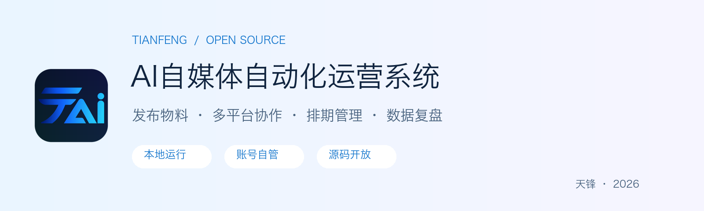
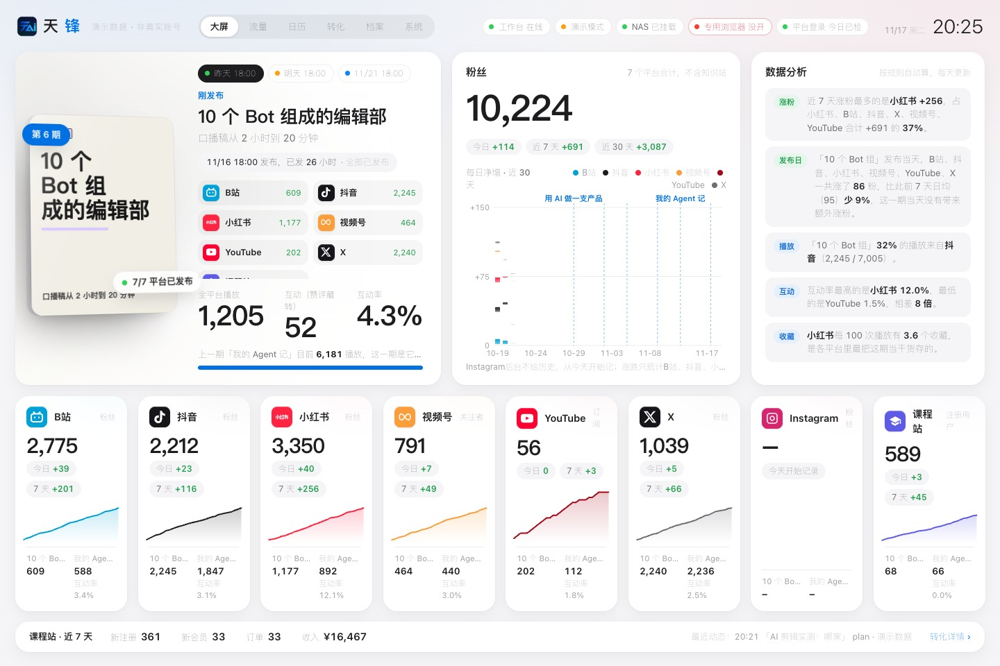

<div align="center">



# AI自媒体自动化运营系统

**把视频发布、平台排期和运营数据，放进同一个本地工作台。**


[下载源码包](https://github.com/icokie91goldiz-arch/ai-self-media-automation/archive/refs/heads/main.zip) · [快速开始](#快速开始) · [功能与平台](#功能与平台) · [交流群](#交流群) · [反馈问题](https://github.com/icokie91goldiz-arch/ai-self-media-automation/issues)

</div>

一条视频剪好了，接下来还要整理文案、适配封面、打开不同平台、核对发布时间，发布后再逐个查数据。这个项目把这些环节连接起来，帮助个人创作者和小团队减少重复操作。

**AI Skill 整理发布工程，发布助手协助上传填写，工作台记录排期、发布状态与运营数据。** 已有视频、封面和文案可以直接作为输入；本项目的范围是自媒体运营，视频拍摄、剪辑和生成由你自己的制作工具完成。

> 当前公开版本：**macOS 本地集成版**。源码目录已完整公开，可在线查看、克隆或下载。工作台、演示模式及本机启动流程已验证；平台真实上传和数据采集需要使用者登录账号后逐项验证。页面中的能力说明不代表每个平台都已完成本地实测。

## 先看界面



*上图来自独立演示模式：播放、粉丝、收入和账号均为样例数据，仅用于展示界面。正式工作台使用自己的账号与数据。*

## 功能与平台

| 你要做的事 | 系统提供什么 |
| --- | --- |
| 整理一期发布素材 | 用 Skill 将已确认的成片、封面和文案整理为发布工程，并检查文件与平台字段 |
| 协助多平台发布 | 复用发布适配器上传素材、填写文案；当前配置由用户完成最终发布 |
| 管理发布时间 | 在日历、分发计划和单期档案中查看安排与状态 |
| 查看内容表现 | 按期、按平台展示播放与互动，记录粉丝变化；数据需登录采集 |
| 复盘自有站点转化 | 可选接入自己的网站，关联来源、注册、订单与收入 |
| 先了解系统效果 | 独立演示模式提供样例页面，正式数据与演示数据隔离 |

| 平台范围 | 当前情况 |
| --- | --- |
| 抖音、小红书、视频号 | 默认配置的平台，需用户登录并验证上传和采集 |
| B站、YouTube、X、Instagram | 源码包含上游适配器，按需配置；本次未完成这些平台的账号实测 |
| 自有网站 | 可选对接，需要你的网站提供对应数据接口 |

平台页面经常变化，实际兼容性以使用时的验证结果为准。系统辅助操作你自己的账号；浏览器登录状态保存在本机。

## 快速开始

### 1. 准备环境

- **macOS**：当前验证环境为 Apple Silicon Mac。Windows / Linux 尚未完成这套集成启动器的验证。
- **Node.js 22.5 或以上**：[官网下载](https://nodejs.org/)。项目使用 Node 内置 SQLite。
- **Python 3**：用于启动脚本；在终端运行 `python3 --version` 检查。
- **Google Chrome**：用于专用的平台登录与发布浏览器。

检查环境：

```bash
node --version
python3 --version
```

### 2. 下载并打开工作台

点击 **[下载完整源码包](https://github.com/icokie91goldiz-arch/ai-self-media-automation/archive/refs/heads/main.zip)**，解压到你自己的可写目录，打开里面的 `ai-self-media-automation-main` 文件夹。

首次使用可以在该文件夹打开终端，运行：

```bash
python3 scripts/manage.py open
```

启动器会生成本机配置、启动工作台，并打开已完成本机访问认证的页面。默认地址为 `http://127.0.0.1:8787/`。本项目不需要执行 `npm install`。

也可以双击 `01_打开天锋工作台.command`。如果文件缺少执行权限，在项目目录运行：

```bash
chmod +x *.command
```

也可以使用 Git 克隆：

```bash
git clone https://github.com/icokie91goldiz-arch/ai-self-media-automation.git
cd ai-self-media-automation
python3 scripts/manage.py open
```

GitHub 页面中的 **Code → Download ZIP** 同样可以下载完整源码。

### 3. 登录平台账号

双击 `02_登录平台账号.command`，在专用 Chrome 窗口中自行登录抖音、小红书和视频号，再双击 `03_检查账号状态.command`。

账号登录、素材上传、平台最终提交和数据采集是不同步骤。首次使用请先用一条自己的内容完成验证，再安排批量任务。

### 4. 先看演示或停止服务

| 入口 | 用途 |
| --- | --- |
| `01_打开天锋工作台.command` | 打开正式工作台 |
| `02_登录平台账号.command` | 打开专用浏览器登录平台 |
| `03_检查账号状态.command` | 检查已配置平台的登录状态 |
| `04_查看演示效果.command` | 打开 `127.0.0.1:8788` 的独立演示 |
| `05_停止天锋服务.command` | 停止正式与演示服务 |

首次启动只运行工作台，自动采集与排期任务默认未启用。启动器会注册用户级 macOS 后台服务；再次登录电脑时，项目目录和所在磁盘需要可用。

## 源码结构

```text
ai-self-media-automation/
├── README.md                 # 项目说明与安装教程
├── scripts/                  # 本地启动与服务管理
├── skills/tianfeng-publish/   # 整理发布工程的 AI Skill
├── tianfeng-workbench/        # 工作台、排期与数据复盘
├── tianfeng-publisher/        # 发布助手与平台适配器
├── docs/assets/              # 首页预览与交流群图片
├── 品牌资源/                  # 天锋 Logo 与品牌素材
├── 上游资料/                  # 来源版本记录
└── 发布工程/                  # 自己的发布素材（不随仓库公开）
```

## 一期视频怎么用


在 `发布工程/` 下为每期建立一个文件夹：

```text
发布工程/
└── 系列名/第01期/
    ├── 成片.mp4
    ├── 发布素材.md
    └── 封面/
        ├── cover-3x4.png
        └── cover-4x3.png
```

将下载包里的 `skills/tianfeng-publish/` 链接或安装到你的 Codex 技能目录后，调用 `$tianfeng-publish` 整理工程。请保留已确认的口播、发布文案和封面，不需要为了接入工具重新制作。

也可以在项目目录手动生成并校验：

```bash
python3 scripts/manage.py tool make-publish.mjs "发布素材.md的完整路径" "当期工程的完整路径"
python3 scripts/manage.py tool validate.mjs "当期工程的完整路径"
```

发布素材的字段格式见下载包中的 `skills/tianfeng-publish/references/发布素材格式.md`。校验通过代表素材与字段通过检查，尚不代表已经发布到平台。

### 发布助手需要单独装吗？

工作台默认直接调用 `tianfeng-publisher/` 内的适配器。希望在日常浏览器里独立使用时，可以在 Chrome 扩展程序管理页开启开发者模式，选择“加载已解压的扩展程序”，选中下载包中的 `tianfeng-publisher/`。

`sidepanel.html` 是扩展界面，不能当成普通网页来操作平台账号。

## 数据保存在什么地方

| 内容 | 位置 |
| --- | --- |
| 本机访问口令、浏览器登录状态、日志 | `~/Library/Application Support/TianfengAutomation/` |
| 正式运营数据库 | `tianfeng-workbench/data/` |
| 独立演示数据 | `tianfeng-workbench/demo/` |
| 你的成片和发布物料 | `发布工程/` |

本机服务默认只监听 `127.0.0.1`。源码包不包含作者的账号、访问口令或运行数据库；换电脑后需要重新登录。提交代码或反馈问题时，请先移除 Cookie、令牌、私人账号信息和客户数据。

## 常见问题

**打开工作台为什么没有数据？**

新安装的正式工作台没有历史账号数据。先登录、检查账号，再完成采集；也可以先打开独立演示了解界面。

**提示“需要访问口令”怎么办？**

使用项目的启动入口，或运行 `python3 scripts/manage.py open`。启动器会在本机处理访问认证，无需把口令发给任何人。

**能不能直接一键生成视频？**

本项目接收已经完成的成片，处理后续发布和运营。视频制作可接入你自己的其他工具。

**为什么网站显示在线，自动任务却未启动？**

工作台服务与后台自动任务分别运行。当前默认只启动工作台，先完成账号与流程验证，再按实际需求配置自动任务。

**可以直接用于 Windows 吗？**

仓库内含上游部分跨平台脚本，但本次交付的统一启动器使用 macOS LaunchAgent。目前不承诺 Windows / Linux 开箱即用。

## 交流群

**天锋 AI 智能体 2 群**：交流 AI 自媒体工作流、本地部署、功能使用和问题排查。

<p align="center"></p>

此二维码由天锋提供，图片注明 **2026 年 11 月 24 日前有效**。若二维码失效，请在 [Issues](https://github.com/icokie91goldiz-arch/ai-self-media-automation/issues) 留言提醒更新；请勿公开登录凭据。

## 反馈与贡献

欢迎在 [Issues](https://github.com/icokie91goldiz-arch/ai-self-media-automation/issues) 提交问题或建议。请说明系统版本、Node 版本、对应平台、复现步骤和已脱敏的错误信息。也欢迎贡献平台适配、安装说明与实际验证记录。

## 开源来源与许可

这是一套由天锋整理的品牌定制与本地集成版本，感谢上游作者 **麦当 mdldm** 的开源工作。

| 部分 | 来源 | 许可证 |
| --- | --- | --- |
| 工作台 | [CzzzzzzJ/mdldm-maitian](https://github.com/CzzzzzzJ/mdldm-maitian) | MIT |
| 发布助手 | [CzzzzzzJ/mdldm-maitian-publisher](https://github.com/CzzzzzzJ/mdldm-maitian-publisher) | Apache-2.0 |
| 本地集成脚本与天锋修改 | 本项目 | MIT |

本次主要修改：天锋品牌和 Logo、本机启动入口、配置与源码分离、仅本机监听、演示模式隔离、运行状态显示、发布 Skill 与中文使用说明。

各组件的原始许可证和来源版本保留在下载包中；根目录 [LICENSE](LICENSE) 与 [NOTICE](NOTICE) 说明本次集成代码和修改。天锋名称与 Logo 属于品牌标识，不因代码开源自动授予品牌使用权。
